


&nbsp;
&nbsp;
&nbsp;

  

I build agents that do real work, and write down how they break.

<!-- NOW:START -->
Now building <a href="https://github.com/Parthkomalwad/reddit-scout-feed"><b>reddit-scout-feed</b></a> &middot; Daily feed of new posts from a few subreddits, for my Reddit Scout…
<!-- NOW:END -->

 

<!-- PROJECTS:START -->

<a href="https://github.com/Parthkomalwad/reddit-scout-feed">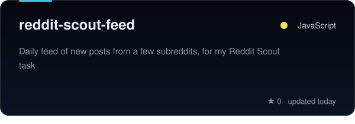</a>&nbsp;
<a href="https://github.com/Parthkomalwad/lean-harness">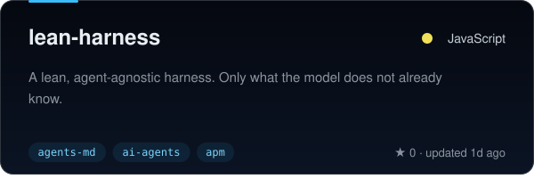</a>
 
<a href="https://github.com/Parthkomalwad/tripline">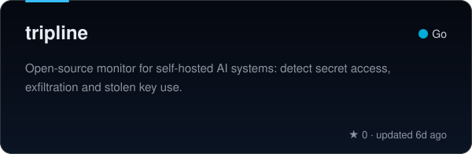</a>&nbsp;
<a href="https://github.com/Parthkomalwad/agentic-harness">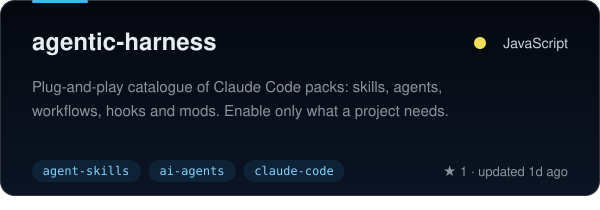</a>
 
<a href="https://github.com/Parthkomalwad/Sable">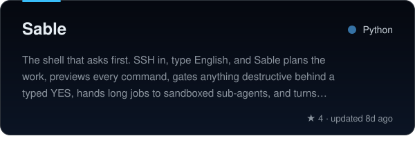</a>&nbsp;
<a href="https://github.com/Parthkomalwad/codemode-deno-executor">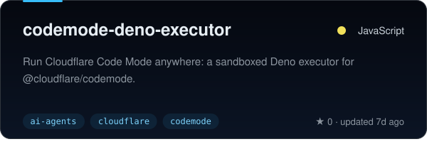</a>
 
<a href="https://github.com/Parthkomalwad/jevbrief">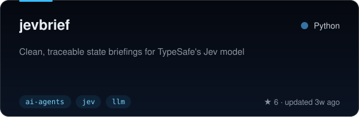</a>&nbsp;
<a href="https://github.com/Parthkomalwad/Archon">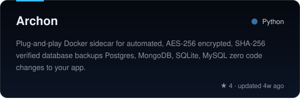</a>
 
<a href="https://github.com/Parthkomalwad/VeritasChain">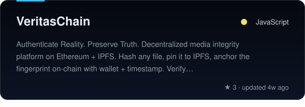</a>

9 public repos, newest activity first. Updated automatically every 6 hours.

<!-- PROJECTS:END -->

<!-- WRITING:START -->
<ul>
<li><a href="https://parthkomalwad.dev/writing/tripline-ai-secret-exfiltration-monitor/"><b>tripline: assume something gets in, make sure it leaves with nothing</b></a> Oct 25, 2026 &middot; tripline is an open-source monitor for self-hosted AI systems. It catches secret access, exfiltration and stolen key use, without predicting how the attacker got in.</li>
<li><a href="https://parthkomalwad.dev/writing/codemode-deno-executor-sandbox/"><b>Running Cloudflare Code Mode outside Workers, in a Deno sandbox</b></a> Oct 21, 2026 &middot; A drop-in executor that runs LLM-generated Code Mode scripts in Deno with every permission denied, in any Node app.</li>
<li><a href="https://parthkomalwad.dev/writing/archon-docker-database-backups/"><b>Archon: encrypted database backups as a Docker sidecar</b></a> Sep 30, 2026 &middot; Archon adds automatic, encrypted, checksum-verified backups for Postgres, MongoDB, MySQL and SQLite to any Docker stack, with no code changes.</li>
</ul>

<a href="https://parthkomalwad.dev/writing/"><b>All writing on parthkomalwad.dev &rarr;</b></a>

<!-- WRITING:END -->

| | |
|---|---|
| **Agents & LLMs** | Multi-agent orchestration · RAG · GraphRAG · NL2SQL · MCP · Llama 3 fine-tuning · LangChain · Claude · OpenAI · Ollama |
| **Data** | Postgres · pgvector · DuckDB · Neo4j · Parquet · Microsoft Fabric |
| **Cloud & Ops** | Azure AI Foundry · AWS · Docker · GitHub Actions · air-gapped deploys |
| **Code** | Python · FastAPI · TypeScript · React 19 · WebAssembly |

 

<picture>
  <source media="(prefers-color-scheme: dark)" srcset="profile-3d-contrib/profile-night-rainbow.svg" />
  <source media="(prefers-color-scheme: light)" srcset="profile-3d-contrib/profile-green-animate.svg" />
  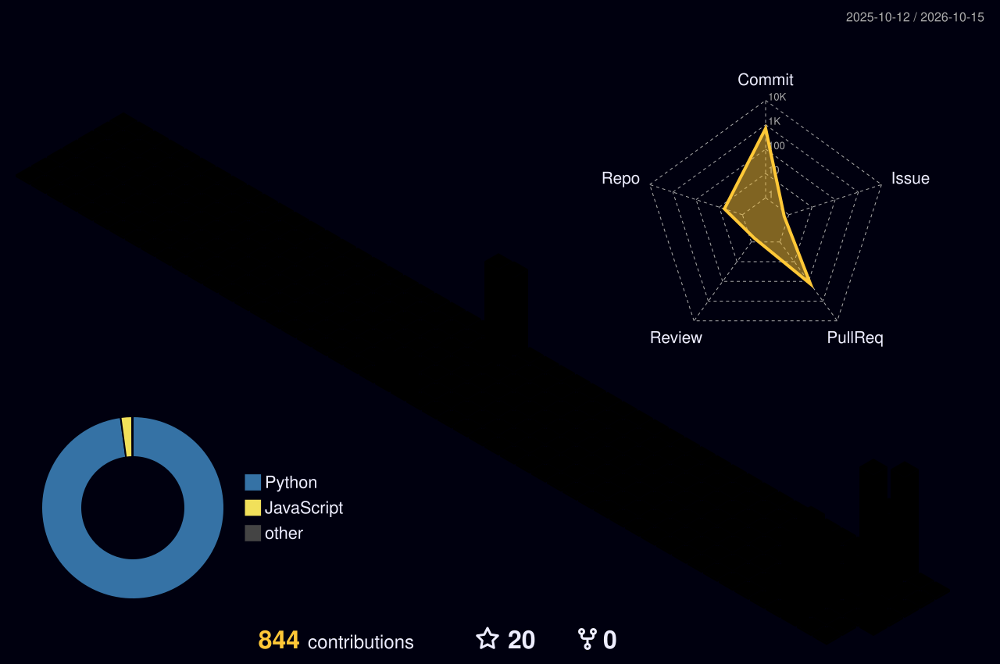
</picture>

 

Open to conversations about agent systems, RAG, and AI platform roles &middot; <a href="mailto:pkomalwad@gmail.com">pkomalwad@gmail.com</a>

